<p align="center">
  
</p>

<h1 align="center">Security Radar</h1>

<p align="center">
  <b>The trigger for AWS Security Agent and AWS Continuum: a security headline from the outside world →<br/>
  the exact line in your code → a validated patch delivered as a pull / merge request —<br/>
  and, until that patch ships, a virtual patch at the edge with AWS WAF and Route 53 Resolver DNS Firewall.</b>
</p>

<p align="center">
  
  
  
</p>

[中文说明](README_CN.md)

> **Preview notice.** This sample calls AWS Continuum code scanning, which is in **public preview**. APIs and behaviour
> may change. Use a non-production AWS account.

## What it is

Attacks on exchanges and DeFi protocols move fast: hot-wallet key leaks and contract exploits are often used within
minutes of disclosure. AWS Security Agent and AWS Continuum can review code, prove exploitability and write patches —
but they do not know **what just happened outside, which line of your code it touches, or when a paid scan is worth it**.

Security Radar is the **source** of that chain. It tracks the outside security world (CISA KEV, vendor advisories,
security media, Web3 incident databases; an X source is available but off by default), decides in code what is real and
what is urgent, and when an event matches your code it **pulls the trigger**:

1. **AWS Security Agent** — the radar writes the event as a security requirement and starts a code review; Security Agent
   returns findings and a fix diff.
2. **AWS Continuum** — the radar submits a finding pinned to the file and line and asks for validation; once Continuum
   proves the issue exploitable it produces a patch and opens a **native pull request (GitHub) or merge request (GitLab)**.
3. **A human** reviews and merges.

Patching takes hours to days; exploitation of a fresh disclosure can take minutes. So the radar also **mitigates what
it located**, on resources it owns, in a non-blocking mode until a human promotes it (see *Fast path* below).

<picture>
  <source media="(prefers-color-scheme: dark)" srcset="docs/diagrams/respond-loop-dark.svg">
  
</picture>

## Key mechanisms

| Mechanism | What it means |
|---|---|
| **Decisions in code, not in an LLM** | De-duplication, independent-source counting, verification level V0–V4, severity P0–P2, version comparison and IOC matching are deterministic code. An LLM (Amazon Bedrock) only writes sentences, each with citations that code checks (citation exists, every number appears in the cited text). |
| **Located to the line** | A pinned vulnerable version or an IOC (address, key) found in your repository becomes a finding with file and line, e.g. `Dockerfile:1`, `composer.json:8`, `.gitlab-ci.yml:2`. When the version cannot be compared, the radar says so and leaves it to Security Agent. |
| **On-chain evidence** | For Web3 incidents the attack transaction is checked on a public RPC node (`eth_getTransactionReceipt`); a successful transaction raises the event to *corroborated*. |
| **Three code hosts, one chain** | Each target lives in exactly one Continuum environment: S3 (patch artifacts), GitHub (native PRs) or GitLab (native MRs). Adding a host is one row in `respond.REPO_CHANNELS`, one adapter in `scripts/sync-fleet.py` and one integration. |
| **Cost guardrails** | A scan is requested only to validate radar findings that were submitted successfully, at most once per environment per 24 h, with scheduled scans off. A daily budget line is flagged on the ops page, never silently enforced. |
| **Operator view** | Daily 08:00 HKT digest (code picks and counts, the LLM writes cited sentences), advisory "possible duplicate" hints, and an ops page listing what needs a human. |

## Fast path: mitigate until the patch ships

A mitigate station runs after the respond step. It acts **only on targets the radar or the AWS agents found affected**
and **only writes resources the radar created** (IAM scopes every write to them). A mitigation is not a fix — every
surface says so.

| Channel | Where the plan comes from (code) | What the radar does | What a human does |
|---|---|---|---|
| **AWS WAF** | The AWS Managed Rules changelog parsed into CVE → rule group / rules / minimum version; then the product (PHP, WordPress); then the weakness class (CWE — advisory only) | Adds the managed rule group to the radar's web ACL with the rules in **Count**, and checks it (group overridden to Count? pinned to a version that predates the CVE?) | `scripts/promote.py waf …` to **Block**; the radar never demotes |
| **Route 53 Resolver DNS Firewall** | Domain indicators written in **defanged** form in the evidence (`evil[.]com`) + the AWS-managed threat lists; major platforms are never blocked | Writes the radar's domain list; rules in **ALERT** | `promote.py dns …` to **BLOCK** |
| **Amazon Inspector** | Target lockfiles → CycloneDX SBOM → `ScanSbom` (stateless, nothing enabled in the account, at most once per target per day) | Per-target dependency baseline; intersects event CVEs with it | Upgrade through the PR / MR channel |
| **AWS Security Hub** (opt-in) | One ASFF finding per event × affected target, with the fix version and every mitigation's state | Imports on change, archives when no longer affected | Triage next to GuardDuty / Inspector findings |

Inspector judges language packages, not runtimes (a PHP or Node.js version pin is judged by the radar's own product
registry). End-to-end checks: `scripts/waf-e2e.py`, `scripts/dns-e2e.py`, `scripts/securityhub-check.py`.

## Architecture

<picture>
  <source media="(prefers-color-scheme: dark)" srcset="docs/diagrams/architecture-dark.svg">
  
</picture>

Serverless on AWS: EventBridge (every 10 min) → Step Functions (plan → collect → process → analyze → respond → mitigate → publish) →
Lambda + DynamoDB + S3 → CloudFront. AWS Security Agent runs in the radar's Region; AWS Continuum runs in `us-east-1`.

| Path | Content |
|---|---|
| `src/radar/` | Parsers, pipeline (normalize → cluster → verify → score), analyst, respond station, on-chain checks, digest, ops rules |
| `infra/` | AWS CDK (Python): three stacks — radar + Security Agent + DNS Firewall demo VPC in `ap-northeast-1`; Continuum side and the WAF demo (a web ACL in front of a CloudFront distribution that refuses every request) in `us-east-1` |
| `integrations/continuum/targets/` | **Deliberately vulnerable** demo repositories used as scan targets (see below) |
| `ui/` | React 18 + Vite + TypeScript; `ui/mock-data/` for local development only |
| `tests/`, `mutations.txt` | pytest (fixtures recorded once, no network) and a mutation registry proving each guard's test fails when the guard is removed |

## Deploy

**Prerequisites:** a **non-production** AWS account; AWS Continuum code scanning (preview) available in the account;
AWS Security Agent in `ap-northeast-1`; Amazon Bedrock access to Anthropic Claude Sonnet / Haiku; CDK bootstrapped in
`ap-northeast-1` and `us-east-1`; `uv`, Node.js ≥ 22, AWS CLI v2.

```bash
export AWS_PROFILE=<non-production-profile>
./scripts/deploy-all.sh                          # build → three CDK stacks → arm the UI gate → upload UI → one cycle → verify
STAGE=demo ./scripts/deploy-all.sh               # an isolated copy (every name carries the stage)
STAGE=demo ./scripts/verify.sh                   # PASS/FAIL acceptance + integration coverage
STAGE=demo ./scripts/destroy-stage.sh            # remove that copy
```

Optional channels: GitHub PRs (`uv run python scripts/sync-fleet.py --channel github --apply`, then authorize the
AWS Continuum GitHub App once and set `github_repo` in `infra/cdk.json`) and GitLab MRs (`--channel gitlab`, with a
personal access token in `~/.env`; set `gitlab_project`, and `gitlab_url` for a self-managed instance reachable by
Continuum).

Optional: AWS Security Hub export with `-c security_hub=on` (an account-wide service — enabled without any default
standards; off by default in this sample).

**Costs.** AWS Continuum code scanning bills per inference unit — see the AWS Continuum pricing page; scans are the
dominant cost, which is why the radar scans only to validate its own findings. Bedrock, Lambda, DynamoDB, S3 and
CloudFront costs are small for one deployment. The fast path adds roughly $10–15 a month (web ACL $5 + $1 per rule,
ScanSbom $0.03 per call, DNS Firewall $0.60 per million queries). Destroy demo stages when you are done.

## ⚠️ Deliberately vulnerable demo code

`integrations/continuum/targets/` contains small repositories that are **vulnerable on purpose** (an unpatched PHP
runtime, a smart contract that trusts a well-known public test key, a Node.js runtime with a
known decompression flaw). They exist only as scan targets for the demo. **Do not deploy them, and do not reuse any key
or address from them.**

## Notes on data sources and access

- Feeds are fetched from their public endpoints and respect each publisher's terms. The X source is **off by default**:
  set `X_SEARCH_URL` and `X_API_KEY` to a data source you are licensed to use, then enable it in `src/radar/registry.py`.
- Test fixtures were recorded once; third-party news text is reduced to title, link, date and one sentence (see `NOTICE`).
- The UI is gated with HTTP Basic Auth at CloudFront (credential generated into AWS Secrets Manager). This is a demo gate,
  not an identity system — for anything beyond a demo, put the site behind Amazon Cognito or AWS IAM Identity Center.

## Security

See [CONTRIBUTING](CONTRIBUTING.md#security-issue-notifications) for more information.

## License

This library is licensed under the MIT-0 License. See the [LICENSE](LICENSE) file. Third-party test fixtures are listed in
[NOTICE](NOTICE).

## Disclaimer

This is sample code for demonstration and education. It is not intended for production use as is. You are responsible
for testing, securing and optimizing it for your own requirements and for complying with the terms of every data source
you connect.
