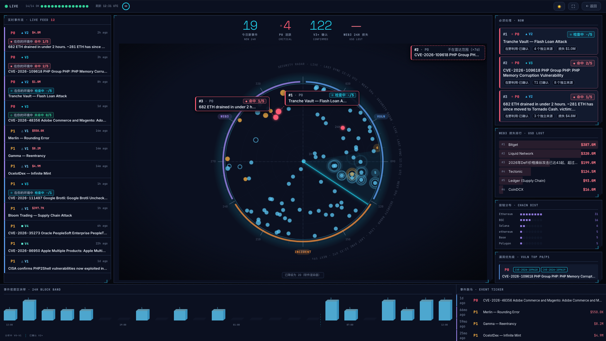
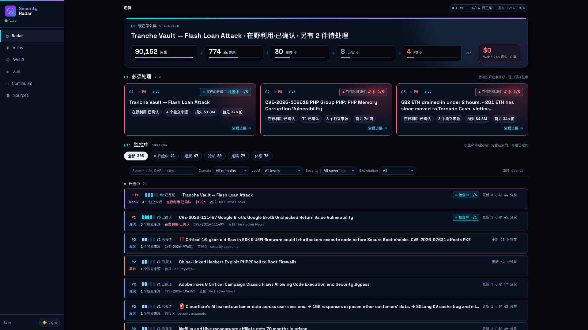
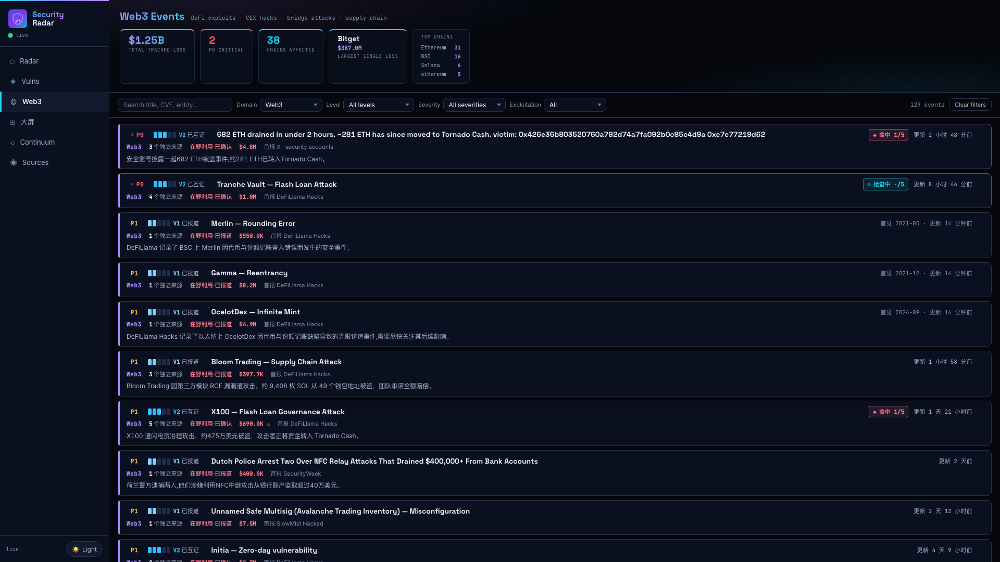
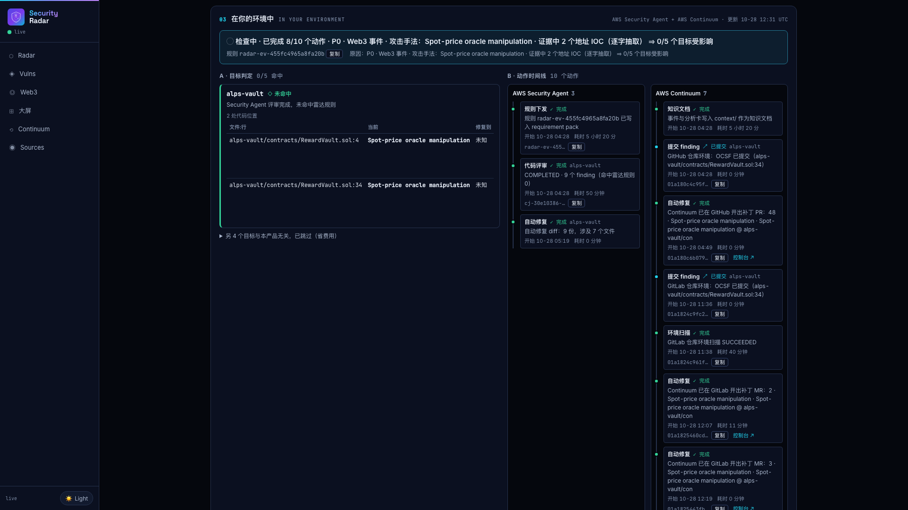
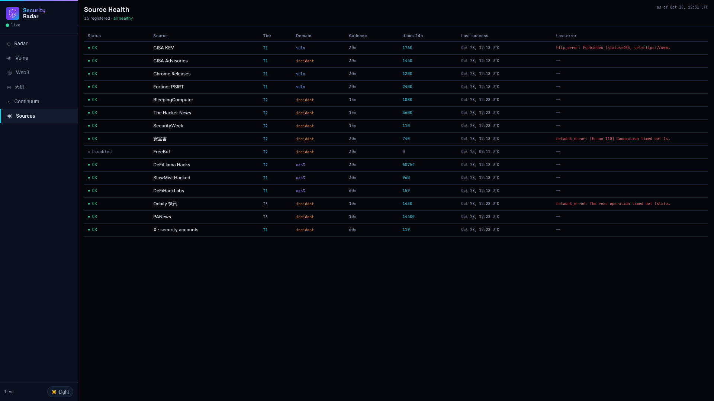

<p align="center">
  
</p>

<h1 align="center">Security Radar</h1>

<p align="center"><b>AWS Security Agent 与 AWS Continuum 的扳机：外部安全事件 → 你代码里精确到行的位置 → 证实可利用并以 PR / MR 交付补丁</b></p>

[English](README.md)

> **预览说明**：本示例调用 AWS Continuum 代码扫描，该功能处于**公开预览**，API 与行为可能变化。请使用非生产账号。

## 它是什么

针对交易所、DeFi 协议的攻击越来越密集：热钱包私钥泄露、合约漏洞被利用，从公开披露到被打往往只有几分钟。
AWS Security Agent 和 AWS Continuum 能审代码、证实可利用、出补丁，但它们回答不了三个问题：
**外面刚发生了什么、该查哪一行、什么时候值得花钱扫**。

Security Radar 是这条链路的**源头**：持续跟踪外部安全世界（CISA KEV、厂商公告、安全媒体、Web3 被盗数据库；X 源已实现但默认关闭），
由代码判断真伪和紧急度；事件一旦对上你的代码，就**扣扳机**：

1. **AWS Security Agent**：雷达把事件写成安全规则并发起代码评审，Security Agent 给出 finding 和修复 diff
2. **AWS Continuum**：雷达提交精确到行的 finding 并请求验证，Continuum 证实可利用后出补丁，**原生开 PR（GitHub）或 MR（GitLab）**
3. **人**：审核并合并

补丁要走评审和发布，而利用可能只要几分钟。所以雷达还会对它定位到的问题**先做缓解**：只改它自己建的资源，
先用不拦截的模式，等人确认后才拦截（见下文「快路」）。

<picture>
  <source media="(prefers-color-scheme: dark)" srcset="docs/diagrams/respond-loop-dark.svg">
  
</picture>

## 界面一览

<picture>
  <source media="(prefers-color-scheme: light)" srcset="docs/screenshots/live-wall-light.png">
  
</picture>

> 大屏（`#/wall`）：近 24 小时雷达扫描、实时事件流、必须处理、Web3 损失排行与链分布。
> 截自作者的部署（2026-10-28）；每个页面都有浅色主题。

<table>
<tr><th>首页 · 态势 / NOW / 生命周期</th><th>Web3 事件</th></tr>
<tr><td width="50%"></td><td width="50%"></td></tr>
<tr><th>事件详情 ·「在你的环境中」：定位到行，Security Agent + Continuum 动作时间线</th><th>信源 · 每个采集器的健康</th></tr>
<tr><td width="50%"></td><td width="50%"></td></tr>
</table>

## 关键机制

| 机制 | 说明 |
|---|---|
| **判定在代码里，不在 LLM 里** | 去重、独立来源计数、真实性 V0–V4、严重度 P0–P2、版本比对、IOC 匹配全部是确定性代码；LLM（Amazon Bedrock）只写句子，每句带引用并由代码校验 |
| **定位到行** | 钉死的受影响版本或 IOC（地址、密钥）在仓库里出现 ⇒ 带文件与行号的 finding；版本无法比较时如实说明，交给 Security Agent |
| **链上证据** | Web3 事件的攻击交易在公共 RPC 上查回执，成功即升为「已佐证」 |
| **三种托管、同一条链** | 每个目标只进一个 Continuum 环境：S3（补丁文件）/ GitHub（原生 PR）/ GitLab（原生 MR） |
| **成本护栏** | 只为验证已提交成功的雷达 finding 才扫描；每个环境 24 小时最多一次；关闭定时扫描；日预算线在运维页标出 |
| **值班视角** | 每日 08:00 HKT 简报（代码选事件与计数，LLM 写带引用的句子）、疑似重复提示、「需要人处理的事」运维页 |

## 快路：补丁上线前先缓解

| 渠道 | 计划从哪来（代码） | 雷达自动做什么 | 人做什么 |
|---|---|---|---|
| **AWS WAF** | 解析 AWS 托管规则 changelog：CVE → 规则组 / 规则 / 最低版本；其次按产品（PHP、WordPress）；再次按 CWE（仅建议） | 在雷达的 web ACL 上挂规则组，规则设为 **Count**，并核查（整组被 Count？版本太旧？） | `scripts/promote.py waf …` 切 **Block**；雷达从不自己降级 |
| **Route 53 DNS Firewall** | 证据里**防篡改写法**的域名（`evil[.]com`）+ AWS 托管威胁列表；主流平台永不拦截 | 写入雷达的域名列表，规则 **ALERT** | 切 **BLOCK** |
| **Amazon Inspector** | 目标 lockfile → SBOM → `ScanSbom`（无状态，不在账号里开通） | 每个目标的依赖基线，并与事件 CVE 求交 | 走 PR / MR 通道升级 |
| **AWS Security Hub**（可选） | 每个「事件 × 受影响目标」一条 ASFF：修复版本 + 各渠道缓解状态 | 内容变化才导入，不再受影响就归档 | 与 GuardDuty / Inspector 一起处理 |

缓解 ≠ 修复：升级到修复版本才是唯一完整的修复。

## 部署

前置：**非生产** AWS 账号、账号已开通 AWS Continuum 代码扫描（预览）、`ap-northeast-1` 可用 AWS Security Agent、
Amazon Bedrock 可调用 Claude Sonnet / Haiku、`ap-northeast-1` 与 `us-east-1` 均已 CDK bootstrap、`uv`、Node.js ≥ 22、AWS CLI v2。

```bash
git clone https://github.com/aws-samples/sample-security-radar.git && cd sample-security-radar
export AWS_PROFILE=<非生产 profile>
./scripts/deploy-all.sh                # 构建 → 三个 CDK 栈 → 布防 UI 门 → 上传 UI → 跑一轮 → 验收
STAGE=demo ./scripts/deploy-all.sh     # 完全独立的副本
STAGE=demo ./scripts/destroy-stage.sh  # 删除副本
```

费用：AWS Continuum 代码扫描按推理单位计费（见 AWS Continuum 定价页），扫描是主要成本，所以雷达只为验证自己的 finding 才扫描。
快路缓解每月约增加 $10–15（web ACL $5 + 每条规则 $1、ScanSbom 每次 $0.03、DNS Firewall 每百万次查询 $0.60）。
Security Hub 导出需 `-c security_hub=on` 才开通（账号级服务，本示例默认关闭，开通时不启用任何默认标准）。

## ⚠️ 故意含漏洞的演示代码

`integrations/continuum/targets/` 下是**故意含漏洞**的小仓库，只作为扫描目标。**不要部署，也不要复用其中任何密钥或地址。**

## 数据源与访问

- 各源取自公开端点并遵守其条款；X 源**默认关闭**，需设置你有授权的数据源 `X_SEARCH_URL` / `X_API_KEY` 后再启用
- 测试夹具只录制一次；第三方新闻正文只保留标题、链接、日期和一句话（见 `NOTICE`）
- UI 在 CloudFront 上用 HTTP Basic Auth 做演示门；超出演示用途请改用 Amazon Cognito 或 AWS IAM Identity Center

## 安全

见 [CONTRIBUTING](CONTRIBUTING.md#security-issue-notifications)。

## 许可

MIT-0，见 [LICENSE](LICENSE)；第三方测试夹具见 [NOTICE](NOTICE)。

## 免责声明

本项目为演示与教学用途的示例代码，不应直接用于生产。请自行测试、加固，并遵守所接入数据源的条款。
