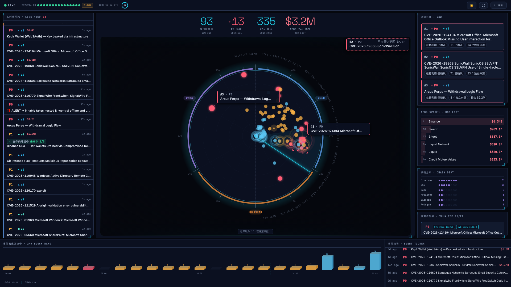
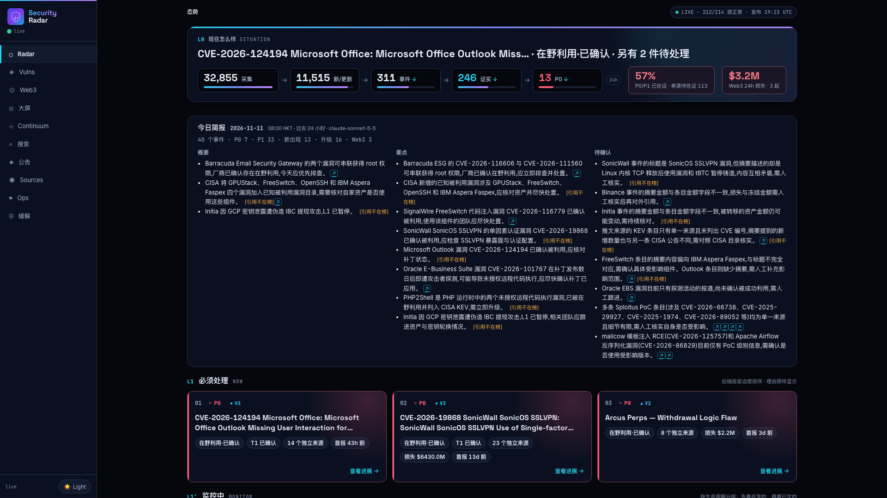
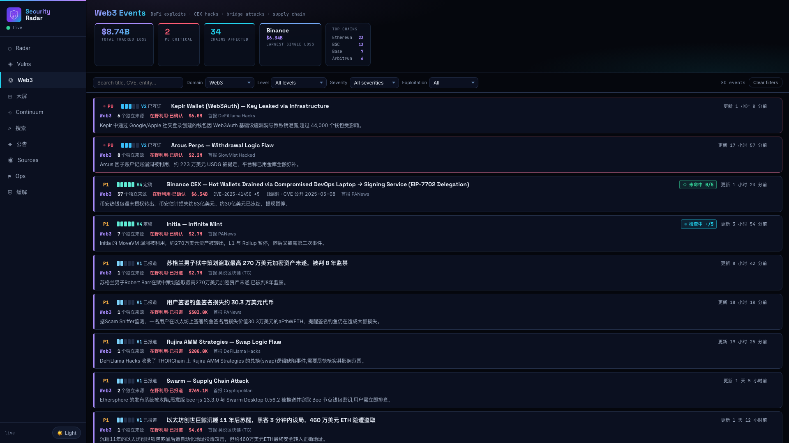
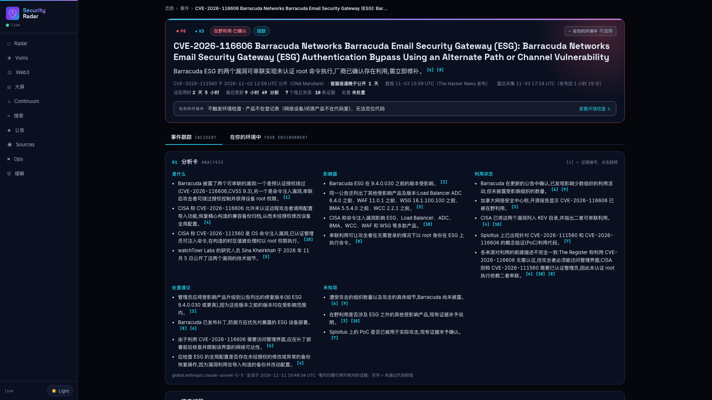
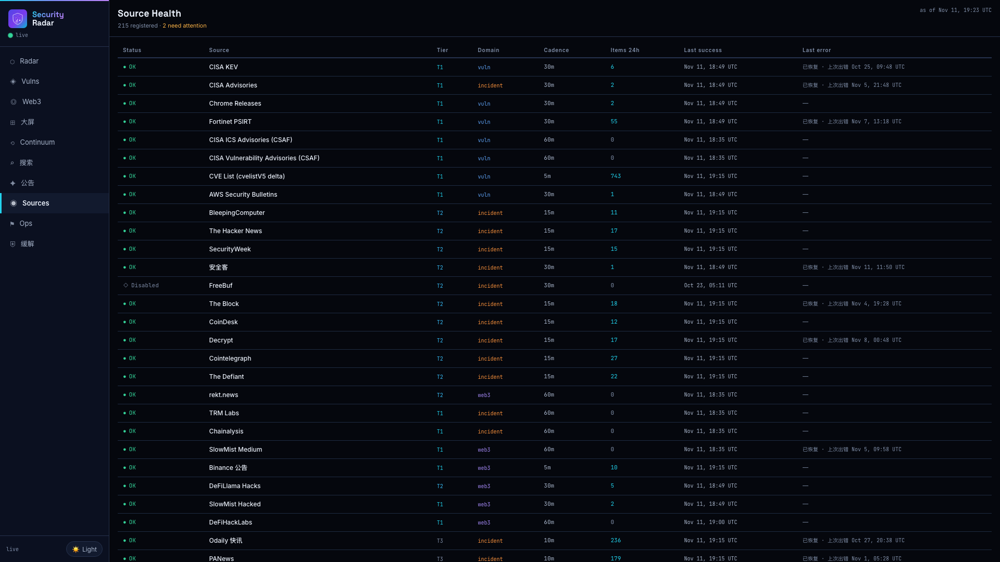

<p align="center">
  
</p>

<h1 align="center">Security Radar</h1>

<p align="center"><b>AWS Security Agent 与 AWS Continuum 的扳机：外部安全事件 → 你代码里精确到行的位置 → 证实可利用并以 PR / MR 交付补丁</b></p>

[English](README.md)

> **预览说明**：本示例调用 AWS Continuum 代码扫描，该功能处于**公开预览**，API 与行为可能变化。请使用非生产账号。

## v1.3.0 更新了什么

完整条目见 [CHANGELOG.md](CHANGELOG.md)。

| 方面 | 变化 |
|---|---|
| **Agent 访问** | Amazon Cognito 客户端凭证令牌 → 经 Amazon API Gateway 只读访问 `GET /api/data/*`；`scripts/radar-token.py` 发放与吊销 |
| **Agent 工具包** | CLI、stdio MCP 服务、`security-radar` skill、`llms.txt` —— 对已发布文档的只读工具 |
| **订阅** | 令牌客户端可自助登记自己的 https webhook（`radar/subscribe`，只能动自己的行）；可按 CVE、利用状态、真实性、损失额与消息类型（含 `digest`）筛选；新渠道 `lark_dm`；新增 `#/subscribe` 页 |
| **信源** | 微软安全更新指南（JSON API）、经 Broadcom 列表 API 的 VMware（第一个 POST 信源）、SonicWall、Ivanti、Google Cloud；每个源每轮 60 秒预算、按主机熔断、退避并遵守 `Retry-After` |
| **可恢复** | 桶开启版本控制、表开启删除保护、`scripts/restore.py`（默认演练） |
| **最小权限** | 每个工位只拿它用到的表操作（无 `Scan`）；Collect 只能写信源状态行（`dynamodb:LeadingKeys`）；Publish 只能写 `data/*` |
| **聚类** | 汇总类文章不合并任何事件；相隔多年的 CVE 不合并；「已被利用」只在说的是该事件时才算 |
| **界面** | 入口 chunk ≤ 120 KB gzip，其余页面按需加载；按首次发现排序；事件页按代码目标给出动作一览；搜索命中直达原文 |

## 它是什么

针对交易所、DeFi 协议的攻击越来越密集：热钱包私钥泄露、合约漏洞被利用，从公开披露到被打往往只有几分钟。
AWS Security Agent 和 AWS Continuum 能审代码、证实可利用、出补丁，但它们回答不了三个问题：
**外面刚发生了什么、该查哪一行、什么时候值得花钱扫**。

Security Radar 是这条链路的**源头**：持续跟踪外部安全世界 —— 200 多个公开信源：CISA KEV 与 CSAF 公告、CVE List 本身、
厂商 PSIRT 与 CERT、AWS 安全公告、安全与加密媒体、Web3 被盗数据库、交易所公告板、公开 Telegram 频道预览、公众号 feed
（X 源已实现但默认关闭），
由代码判断真伪和紧急度；事件一旦对上你的代码，就**扣扳机**：

1. **AWS Security Agent**：雷达把事件写成安全规则并发起代码评审，Security Agent 给出 finding 和修复 diff
2. **AWS Continuum**：雷达提交精确到行的 finding 并请求验证，Continuum 证实可利用后出补丁，**原生开 PR（GitHub）或 MR（GitLab）**
3. **人**：审核并合并

补丁要走评审和发布，而利用可能只要几分钟。所以雷达还会对它定位到的问题**先做缓解**：只改它自己建的资源，
先用不拦截的模式，等人确认后才拦截（见下文「快路」）。

<picture>
  <source media="(prefers-color-scheme: dark)" srcset="docs/assets/respond-loop-dark.svg">
  
</picture>

## 界面一览

<picture>
  <source media="(prefers-color-scheme: light)" srcset="docs/screenshots/live-wall-light.png">
  
</picture>

> 大屏（`#/wall`）：近 24 小时雷达扫描、实时事件流、必须处理、Web3 损失排行与链分布。
> 截自作者的部署（2026-10-28，v1.2.0 之前）；每个页面都有浅色主题。

<table>
<tr><th>首页 · 态势 / NOW / 生命周期</th><th>Web3 事件</th></tr>
<tr><td width="50%"></td><td width="50%"></td></tr>
<tr><th>事件详情 ·「在你的环境中」：定位到行，Security Agent + Continuum 动作时间线</th><th>信源 · 每个采集器的健康</th></tr>
<tr><td width="50%"></td><td width="50%"></td></tr>
</table>

## 关键机制

| 机制 | 说明 |
|---|---|
| **判定在代码里，不在 LLM 里** | 去重、独立来源计数、真实性 V0–V4、严重度 P0–P2、版本比对、IOC 匹配全部是确定性代码；LLM（Amazon Bedrock）只写句子，每句带引用并由代码校验 |
| **定位到行** | 钉死的受影响版本或 IOC（地址、密钥）在仓库里出现 ⇒ 带文件与行号的 finding；版本无法比较时如实说明，交给 Security Agent |
| **链上证据** | Web3 事件的攻击交易在公共 RPC 上查回执，成功即升为「已佐证」；新事件用公开 JSON-RPC 复盘（ERC-20 流出、发行方冻结），每笔已证实的攻击交易按代币拆解 |
| **聚类用数字管** | 一起事件、多篇报道：按硬链接（CVE、交易、引用的原文）和受害者名称合并 —— 名字只指向它命名的事件，不指向报道里提到它的每个事件；放错的单条报道可以移动（`scripts/move_item.py`），移动后不会回流 |
| **错了能知道** | 事件在一轮内变形、站点连续失败或停摆、信源停采或沉默，都是运维页上的条目；5 个 Amazon CloudWatch 告警经 Amazon SNS 通知负责人；「发布 → 持有」与「成为 P0 → 推送」的时效每轮都在量 |
| **一张响应决策表** | 评审、finding、扫描、补丁交付、通知、缓解，每个动作都由代码里的一张表决定；事件页显示结果、原因码与时间，「没评估」与「没触发」长得不一样 |
| **三种托管、同一条链** | 每个目标只进一个 Continuum 环境：S3（补丁文件）/ GitHub（原生 PR）/ GitLab（原生 MR） |
| **成本护栏** | 只为验证已提交成功的雷达 finding 才扫描；每个环境 24 小时最多一次；关闭定时扫描；日预算线在运维页标出 |
| **值班视角** | 每日 08:00 HKT 简报（代码选事件与计数，LLM 写带引用的句子）、疑似重复提示、「需要人处理的事」运维页、搜索发布过的每个事件、交易所公告板 |
| **通知** | 按渠道订阅（Slack 频道 / 私信、Lark 群 / 私信、带签名的 webhook），可设筛选与消息类型，由 Publish 之后的独立工位发送；另有已发布事件的 Atom / JSON feed。用 `scripts/set-notify.sh` 配置，或由令牌客户端自助登记 webhook（见下） |

## 快路：补丁上线前先缓解

| 渠道 | 计划从哪来（代码） | 雷达自动做什么 | 人做什么 |
|---|---|---|---|
| **AWS WAF** | 解析 AWS 托管规则 changelog：CVE → 规则组 / 规则 / 最低版本；其次按产品（PHP、WordPress）；再次按 CWE（仅建议） | 在雷达的 web ACL 上挂规则组，规则设为 **Count**，并核查（整组被 Count？版本太旧？） | `scripts/promote.py waf …` 切 **Block** —— 晋升时记下批准的规则，之后只拦这些；后来的事件想加的规则留在 Count 并上报。雷达从不自己降级 |
| **Route 53 DNS Firewall** | 证据里**防篡改写法**的域名（`evil[.]com`）+ AWS 托管威胁列表；主流平台永不拦截 | 写入雷达的域名列表，规则 **ALERT** | 切 **BLOCK** —— 批准的规则只拦批准时的域名，之后的留在 ALERT |
| **Amazon Inspector** | 目标 lockfile → SBOM → `ScanSbom`（无状态，不在账号里开通） | 每个目标的依赖基线，并与事件 CVE 求交 | 走 PR / MR 通道升级 |
| **AWS Security Hub**（可选） | 每个「事件 × 受影响目标」一条 ASFF：修复版本 + 各渠道缓解状态 | 内容变化才导入，不再受影响就归档 | 与 GuardDuty / Inspector 一起处理 |

每个事件还会生成一份 **WAF 规则包**：自定义规则取自钉住版本的 nuclei 模板或证据句子里的原文特征，经离线匹配器校验，
容量用只读的 `CheckCapacity` 查，导出为 wafv2 JSON、CloudFormation、Terraform 和 AWS CLI 文本，由人来应用 —— 雷达自己不应用规则包。

缓解 ≠ 修复：升级到修复版本才是唯一完整的修复。

## Agent 访问与订阅

界面仍然只读。Agent 和脚本经令牌把关的 API 读同一批已发布文档；这个 API 唯一的写操作是订阅者登记**自己的** webhook。

- **令牌**：运维者给每个使用方发一个 Amazon Cognito 应用客户端（客户端凭证模式，scope `radar/read`，令牌一小时有效），
  把它写出的 0600 文件交给对方 —— 密钥从不打印：
  ```bash
  AWS_PROFILE=<profile> uv run python scripts/radar-token.py create <name> [--subscribe]
  AWS_PROFILE=<profile> uv run python scripts/radar-token.py list
  AWS_PROFILE=<profile> uv run python scripts/radar-token.py revoke <name> --yes
  AWS_PROFILE=<profile> uv run python scripts/radar-token.py usage --days 7   # 谁读了多少
  ```
  文件里是 `RADAR_URL`、`RADAR_TOKEN_URL`（`https://<domain-prefix>.auth.<region>.amazoncognito.com/oauth2/token`，
  即栈输出 `ApiTokenUrl`）、`RADAR_CLIENT_ID`、`RADAR_CLIENT_SECRET`。吊销后拿不到新令牌，手里的令牌一小时内过期。
- **能读什么**：`GET <site>/api/data/*` —— CloudFront 把 `/api/*` 转给 Amazon API Gateway REST API，由 Cognito
  授权器校验签名、有效期与 scope；一个 Lambda 只读站点桶的 `data/*`。全部文档见 `ui/public/llms.txt`，结构见
  `schemas/site-data.schema.json`。
- **CLI 与 MCP 服务**（`src/radar/agentkit/`，只用标准库；凭证取自环境变量，遇重定向不外发）：
  ```bash
  set -a; source ~/.config/security-radar/clients/<name>.env; set +a   # radar-token.py 写出的文件
  uv run python -m radar.agentkit.cli recent_events --severity P0 --hours 24
  uv run python -m radar.agentkit.cli cve_status --cve CVE-2026-12345
  uv run python -m radar.agentkit.cli --list
  ```
  同一组工具（`recent_events`、`get_event`、`search_events`、`cve_status`、`rule_pack`、`health`、`feeds`）也以 stdio
  MCP 服务提供，不开任何端口：
  ```json
  {"mcpServers": {"security-radar": {"command": "uv", "args": ["run", "--directory", "<radar checkout>", "python", "-m", "radar.agentkit.mcp"],
    "env": {"RADAR_URL": "https://<your radar site>"}}}}
  ```
  给编码 agent 用的 skill 在 `integrations/skill/security-radar/SKILL.md`。
- **自助 webhook**：带 `--subscribe` 发放的客户端（scope `radar/subscribe`）可以列出、添加、删除自己的 https webhook；
  别人的订阅一律「不存在」。签名密钥写进 0600 文件，用它校验 `X-Radar-Signature`。这不在 agent 工具里 —— 登记端点由人决定：
  ```bash
  uv run python -m radar.agentkit.subscriptions add --target https://<your-endpoint> --filters '{"severity": ["P0"], "kinds": ["p0", "update", "digest"]}'
  uv run python -m radar.agentkit.subscriptions list
  uv run python -m radar.agentkit.subscriptions remove --id <id>
  ```
- **消息类型**（`kinds` 筛选）：`p0`、`update`（P0 线程跟着事件走；事件被合并或撤回时补发一次更正）、`waf`、`verdict`、
  `pr`、`digest`（每日简报，列出才发）。事件筛选：`severity`、`domain`、`cves`、`exploitation`、`min_level`、
  `min_loss_usd`。运维者配置的渠道新增 `lark_dm`（按 open_id 或邮箱发给个人）。`#/subscribe` 页列出 feed、webhook 与 agent 三种方式。

## 架构

<picture>
  <source media="(prefers-color-scheme: dark)" srcset="docs/assets/architecture-dark.svg">
  
</picture>

AWS 无服务器，5 分钟一轮：EventBridge → Step Functions（plan → collect → process → analyze → respond → mitigate →
publish → notify）→ Lambda + DynamoDB + S3 → CloudFront。采集是增量、分批的；上一轮没跑完时这一轮自己跳过。
CloudWatch 告警 → SNS → 一个小 Lambda 通知负责人。Agent 经 Amazon API Gateway 读取（`/api/*`，Amazon Cognito 令牌）。AWS Security Agent 与雷达同区；AWS Continuum 在 `us-east-1`。

## 部署

前置：**非生产** AWS 账号、账号已开通 AWS Continuum 代码扫描（预览）、`ap-northeast-1` 可用 AWS Security Agent、
Amazon Bedrock 可调用 Claude Sonnet / Haiku、`ap-northeast-1` 与 `us-east-1` 均已 CDK bootstrap、`uv`、Node.js ≥ 22、AWS CLI v2。

```bash
git clone https://github.com/aws-samples/sample-security-radar.git && cd sample-security-radar
export AWS_PROFILE=<非生产 profile>
./scripts/deploy-all.sh                # 部署前检查 → 构建 → 三个 CDK 栈 → 布防 UI 门 → 上传 UI → 跑一轮 → 验收 → 比对站点
STAGE=demo ./scripts/deploy-all.sh     # 完全独立的副本
STAGE=demo ./scripts/destroy-stage.sh  # 删除副本
```

费用：AWS Continuum 代码扫描按推理单位计费（见 AWS Continuum 定价页），扫描是主要成本，所以雷达只为验证自己的 finding 才扫描。
快路缓解每月约增加 $10–15（web ACL $5 + 每条规则 $1、ScanSbom 每次 $0.03、DNS Firewall 每百万次查询 $0.60）。
Security Hub 导出需 `-c security_hub=on` 才开通（账号级服务，本示例默认关闭，开通时不启用任何默认标准）。

可选通知：把机器人凭证与频道 id 写进 `~/.env`，运行 `scripts/set-notify.sh`（写入一个 AWS Secrets Manager 密钥，值不会出现在命令行上）。告警发给负责人的订阅。

## ⚠️ 故意含漏洞的演示代码

`integrations/continuum/targets/` 下是**故意含漏洞**的小仓库，只作为扫描目标。**不要部署，也不要复用其中任何密钥或地址。**

## 数据源与访问

- 各源取自公开端点并遵守其条款；X 源**默认关闭**，需设置你有授权的数据源 `X_SEARCH_URL` / `X_API_KEY` 后再启用
- 登记表里的每个源都经 `scripts/source-onboard.py` 准入（从部署账号的 AWS 出口抓取，用线上解析器读）。Telegram 频道读的是公开预览页；
  公众号文章经第三方 RSS 服务 `wechat2rss.xlab.app` 读取 —— 保持启用前请确认是否适合你的用途（`python -m radar.registry --explain` 列出全部信源）
- 可选付费回退：配置了 `FIRECRAWL_API_KEY` 时，被封的 feed 抓取会经 Firecrawl API 重试一次（该 feed 的 URL 会发送到 `api.firecrawl.dev`）（每个源每天有上限），该源标为降级；没有 key 就不会向它发任何请求
- 测试夹具只录制一次；第三方新闻正文只保留标题、链接、日期和一句话（见 `NOTICE`）
- UI 在 CloudFront 上用 HTTP Basic Auth 做演示门；超出演示用途请改用 Amazon Cognito 或 AWS IAM Identity Center
- `/api/*` 不走这道门：只认带正确 scope 的有效 Amazon Cognito 令牌

## 安全考虑

在演示账户以外运行之前，请先看这三点。

- **访问日志含读者 IP。** Amazon CloudFront 标准日志（站点请求：客户端 IP、User-Agent、路径；不含 Cookie 与请求头）
  写入私有存储桶，30 天后删除（`infra/stack.py` 中的 `ACCESS_LOG_DAYS`）；Amazon API Gateway 访问日志（客户端 IP、
  方法、路径、状态码）在 Amazon CloudWatch Logs 保留一个月。请按你自己的隐私与保留策略调整，并告知站点使用者。
- **生产环境请在站点与 API 前面加 AWS WAF。** 本示例不部署自己的 web ACL。CloudFront 分发与 API Gateway 阶段都可从
  公网访问，`execute-api` 地址可以绕过 CloudFront 直接调用。无论哪条路径，所有数据路由都在同一个 Amazon Cognito
  授权器之后，且阶段有限流（每秒 20 次、突发 40），但生产基线是在两个入口都挂上带 AWS 托管规则组与限速规则的 web ACL。
- **自助 webhook 默认关闭。** 已登录的客户端可以登记 https webhook，但通知配置为 `"rollout": "owner_only"`（默认）时，
  通知站不会向它发送任何内容，只有标记 `owner: true` 的订阅会收到消息。雷达只检查目标是 443 端口的 https、
  且 DNS 名称解析到公网地址 —— **不验证**登记者是否拥有该端点。改成 `"rollout": "all"` 之前，请先确定谁可以登录；
  如果团队以外的客户端也能登记，请加上所有权校验（例如确认请求）。

## 安全

见 [CONTRIBUTING](CONTRIBUTING.md#security-issue-notifications)。

## 许可

MIT-0，见 [LICENSE](LICENSE)；第三方测试夹具见 [NOTICE](NOTICE)。

## 免责声明

本项目为演示与教学用途的示例代码，不应直接用于生产。请自行测试、加固，并遵守所接入数据源的条款。
